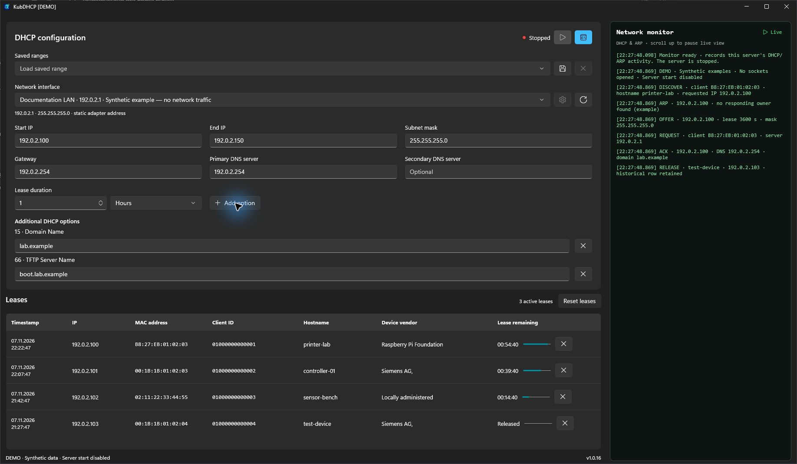
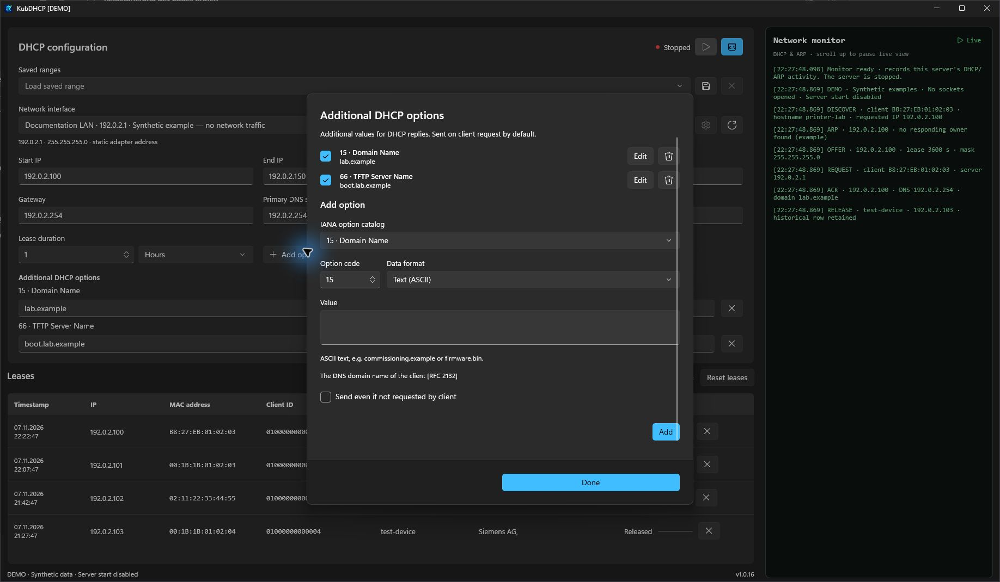
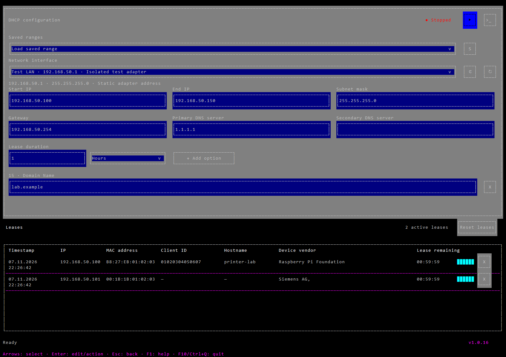
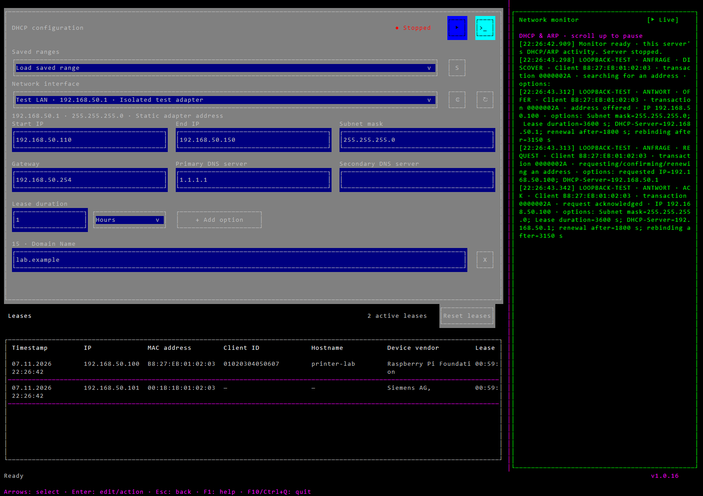

<p align="center">
  
</p>
<p align="center">100% Vibecoded with Codex</p>

# KubDHCP — User guide

[Deutsch](docs/Manual.de.md) · [Latest release](https://github.com/nkxy1/KubDHCP/releases/latest)

KubDHCP is a portable DHCPv4 server for commissioning directly connected devices on Windows x64. WinUI and the terminal interface share one executable, DHCP engine, version and data store. The server always starts **stopped** and runs only while the application is open.

## Download, launch and language

Download **KubDHCP.exe** from the release assets. Keep that filename; put versions in the containing folder, such as `v1.0.19/KubDHCP.exe`. No separate .NET runtime, Windows App Runtime or service installation is needed. On first launch, a native starter displays extraction progress and caches the bundled application under `%LOCALAPPDATA%\KubDHCP.Runtime`. Later launches reuse the cache without showing the extraction window. With `--tui`, extraction progress appears in the calling terminal.

Double-click the EXE for WinUI. For the terminal interface, run:

```powershell
& 'C:\Tools\KubDHCP\KubDHCP.exe' --tui
```

The interface uses **German for German Windows display languages and English for all others**. Restart after changing the Windows display language. Override for one launch with `--language=en` or `--language=de`; both work with WinUI and `--tui`.

Use `--demo` for synthetic examples without opening DHCP sockets or changing adapters. It disables server start and stores disposable example data under `%TEMP%\KubDHCP-demo`. For example:

```powershell
& '.\KubDHCP.exe' --demo --language=en
& '.\KubDHCP.exe' --tui --demo --language=en
```

Use a deliberately chosen commissioning network. KubDHCP does not reliably detect other DHCP servers. An unanswered ARP probe does not guarantee that an IP address is free.

## WinUI: configure and start



This real WinUI screenshot uses demo mode. Device identities and monitor traffic are examples; no DHCP server is running.

1. Select the **Network interface** connected to your devices. Only active IPv4 adapters are listed. The circular-arrow button refreshes the list after connecting or reconfiguring an adapter.
2. Check **Start IP**, **End IP** and **Subnet mask**. Defaults come from the adapter; a `.100–.150` pool is preferred when the subnet and infrastructure addresses permit it. Local adapter, gateway and DNS addresses are excluded from the proposal. Other statically assigned devices cannot be detected reliably.
3. Enter **Gateway**, **Primary DNS server** and optionally **Secondary DNS server**, or leave these fields empty. A secondary DNS server requires a primary one. The gateway must be in the local subnet. Advertising these addresses does not make KubDHCP a router or DNS server.
4. Set a positive whole-number **Lease duration** in seconds, minutes, hours or days. The resulting duration must be 1–4,294,967,294 seconds. A client may request a shorter duration.
5. Configure additional DHCP options if required, then click **play** to start the server. The status changes to running and the button becomes **stop**. Hover over icons for tooltips.
6. Stop before changing the adapter, pool or options. Closing the application also stops the server. Stopping does not revoke IP addresses already held by clients.

The program validates subnet masks, pool bounds, infrastructure overlap, lease duration and option encoding. Active leases outside a smaller proposed pool prevent startup. Disconnection or a change in the selected IPv4 interface configuration stops the server.

The **gear** opens Windows properties for the selected adapter. Changes there affect Windows and may require administrator privileges. Return to KubDHCP to refresh the values. Starting the DHCP server does not automatically alter adapter, firewall, routing or service settings.

### Named ranges and drafts

A named range stores adapter selection, pool, mask, gateway, DNS, lease duration and additional options. Click **save**, enter a name and confirm. Reusing a name, ignoring case and surrounding whitespace, replaces that saved range. Select a name in **Saved ranges** to restore it while stopped. Its adapter and IPv4 configuration must still match.

The adjacent **X** deletes the selected saved range while retaining current form values, leases and other ranges. Valid form edits are also persisted as the current draft; named ranges are independently reusable configurations.

### Additional options



Click **Add option**. Select an offline IANA catalog entry or a custom code from 1 to 254, choose the format and enter a value. The dialog shows descriptions, references and format help. Duplicate codes and protocol/client-managed options are rejected. Values controlled by the main form cannot be added again here.

| Format | Example and interpretation |
| --- | --- |
| Text (ASCII) | `lab.example`; for example domain (15), boot server (66), boot filename (67) |
| IPv4 | `192.0.2.10`, four decimal octets |
| IPv4 list | `192.0.2.10,192.0.2.11`; commas, semicolons or newlines separate addresses |
| UInt8 / UInt16 / UInt32 | `120`; unsigned integer, multi-byte values in network byte order |
| Boolean | `true`/`false`, `1`/`0`, or German `ja`/`nein` |
| Domain list | `lab.example,office.example`; encoded as DNS labels for option 119 |
| Routes | `10.20.0.0/16=192.0.2.254`; one network/prefix=gateway per line or separated by semicolons, options 121/249 |
| Hex | `01 04 C0 00 02 FE`; complete raw bytes, including any vendor suboptions |

Use **Edit** to modify an entry, its checkbox to enable/disable it, and its remove icon to delete it. Values can also be edited inline in the main form. Invalid inline values are highlighted and prevent startup until corrected. In the TUI, click an option title to edit its full definition. Options are read-only while running.

Extra options normally go only to clients requesting their codes in the Parameter Request List. **Send even if not requested by client** overrides this for the selected option. Long values are concatenated according to RFC 3396. Replies exceeding the client's allowed size are rejected with a diagnostic rather than truncated. Incoming option overload is supported; outgoing overload is not used.

### Lease table

Confirmed leases show the last confirmation timestamp, IP, MAC, supplied client ID, hostname, offline vendor lookup and remaining time/progress. Offers alone do not create confirmed rows. Renewals update the row; released and expired rows remain as history. Missing supplied IDs or hostnames appear as a dash. The supplied client ID takes precedence over MAC for identity; hostnames come from hostname/FQDN options.

Vendor lookup uses the bundled IEEE prefix database without online requests. Locally administered MAC addresses are labelled accordingly.

- **Right-click** a value to copy that single value.
- **Drag column dividers** to resize adjacent columns; scroll horizontally for wide tables.
- **X on a lease row** deletes that exact stored record, including while running. A stale selection cannot delete a renewed row. Deletion does not revoke the client's current address.
- **Reset leases** deletes all saved lease records and requires a stopped server. Named ranges remain intact. Account for clients that may still hold unexpired leases before resetting.

The active count and shared version are displayed near the table/footer. The form adapts to window width and becomes scrollable on smaller screens.

### Network monitor

The monitor icon opens the side panel. It shows received and ignored packets, requests/replies, ARP probes, conflicts and diagnostics, including client identity, transaction, addresses, lease times and options actually received/sent. It monitors this server's activity rather than all traffic on the network.

Drag the divider to resize. Scrolling upward pauses the live view with a blinking **PAUSE** indicator. Click the live/pause control for manual pause/resume. Scrolling to the bottom resumes following unless manually paused. Resuming displays buffered messages. Hiding the panel preserves its width and the main window's position/height. The bounded queue reports dropped messages under heavy load.

## Terminal interface





These TUI snapshots are exported from the actual application's character/colour buffers with synthetic test devices, rather than drawn mockups. Native terminal input/output and the validation DHCP exchange are separately exercised on isolated loopback ports.

`--tui` runs in the calling interactive PowerShell/SSH terminal. It never allocates a replacement console or opens a graphical dialog. PowerShell waits until exit; the previous screen, input modes and cursor are restored. Resizing adapts columns, scrolling and dialogs without changing WinUI. WinUI and TUI cannot run concurrently against the same user's data.

| Action | Keys or mouse |
| --- | --- |
| Select | Spatial arrow navigation; Tab / Shift+Tab; click |
| Activate a selected field | Enter; selecting alone does not accept typing |
| Apply / revert editing | Enter / Escape; Ctrl+Enter for multiline input |
| Select all / paste | Ctrl+A / Ctrl+V while editing, or terminal paste |
| Activate button/dropdown | Enter / Space or click |
| Table/monitor interaction | Enter, arrows and Page Up/Down; Escape returns to navigation |
| Copy table value | Right-click |
| Resize columns/monitor | Drag header/divider |
| Edit full option definition | Click option title |
| Help / close dialog | F1 / Escape |
| Quit | F10 / Ctrl+Q |

The top buttons provide start/stop, monitor, save range (`S`), remove range (`X`), adapter settings (gear) and refresh. Per-row `X` and **Reset leases** match WinUI. Fields, saved ranges, additional options, lease history and monitor behavior are shared.

The terminal adapter dialog can request DHCP addressing or apply static IPv4, mask, gateway and DNS using Windows `netsh`. It requires an elevated session. Changing the SSH interface's IP can disconnect you; read the warning before applying. No graphical adapter dialog is opened.

### SSH

Connect to a Windows SSH server with pseudoconsole support using `ssh -t user@windows-host`, then run `KubDHCP.exe --tui` there. The DHCP server uses the **remote computer's** interfaces, firewall permissions and user profile. Mouse control requires SGR mouse support/forwarding. Shift commonly allows local terminal selection while mouse reporting is enabled. Remote copy uses OSC 52, which the local terminal must allow; KubDHCP does not write to the remote desktop clipboard in SSH sessions. Local ConPTY tests do not claim to verify an actual remote SSH host.

## User data, backups and migration

From v1.0.16, normal application data is stored in the current Windows user's profile:

```text
%LOCALAPPDATA%\KubDHCP
```

Usually this is `C:\Users\<user>\AppData\Local\KubDHCP`. Both interfaces and different EXE copies/versions share it. Moving the EXE does not move data. No application state is written next to the EXE.

| File | Purpose |
| --- | --- |
| `settings.json` | Current valid configuration and extra options |
| `ranges.json` | Named saved configurations |
| `leases.json` | Durable lease allocations across restarts |
| `*.json.bak` | Previous versions of corresponding JSON files |
| `KubDHCP.log` | Server activity/error diagnostics |
| `Lizenzen.txt`, `KubDHCP.ico` | Bundled notices and extracted icon |

On first start, if the user data folder does not exist, legacy files from `KubDHCP.data` beside that EXE are copied into the profile. The complete copy is staged before activation; originals are retained. An existing user folder takes priority, with no merge/overwrite. Avoid running an older EXE against the old copy after migration, because it would maintain separate lease state.

Stop the application before backing up, transferring or restoring the complete data folder. Corrupt lease state blocks startup: inspect `leases.json` and its backup instead of blindly deleting allocations while clients may still use them. Startup diagnostics may be written to `%TEMP%\KubDHCP-startup.log` or `%TEMP%\KubDHCP-unhandled.log`. Demo and automated test data use separate temporary folders.

## Troubleshooting and scope

| Symptom | Check |
| --- | --- |
| No adapter | Connect the network, assign a regular IPv4 address in Windows, refresh. Loopback/tunnel adapters are excluded; invalid/APIPA server addresses are rejected. |
| UDP 67 busy | Check another DHCP server or Internet Connection Sharing. |
| No lease | Check adapter, subnet/pool, cabling, firewall access for the EXE and UDP 67/68. Inspect ignored packets, conflicts and oversized options in the monitor. |
| Pool exhausted | Inspect active leases, pending offers and conflicts. Offers expire after 30 seconds; conflicts are quarantined for ten minutes. RELEASE frees an address and keeps history. |
| Options read-only | Stop before modifying configuration. |
| Saved range unavailable | Its original adapter/address/mask must still match. |
| TUI cannot start | Use an interactive terminal; request one with `ssh -t`. No fallback window is opened. |

Supported: DHCPv4 DISCOVER/OFFER, REQUEST/ACK/NAK, renew/rebind, RELEASE, DECLINE and INFORM for direct Ethernet clients. Incoming interface checks and explicit outgoing source/interface selection constrain replies to the chosen adapter. Initial replies use RFC 2131 broadcast fallback; renewals may use unicast. Client ID, hostname/FQDN, incoming overload and concatenated options are supported.

Not included: DHCPv6, DHCP relay, BOOTP, reservation management, DNS, NAT, routing, TFTP or HTTP services. Boot options advertise values without hosting files.

## Build and validation

Use Windows x64, PowerShell 7 and .NET SDK 10.0.403 or its configured compatible patch:

```powershell
.\scripts\Build.ps1
```

The script uses `.tools/dotnet/dotnet.exe` if present, otherwise the installed SDK. It downloads the pinned Zig 0.13.0 compiler with SHA256 verification into `%LOCALAPPDATA%\KubDHCP.BuildTools` for the native starter. It runs core tests, publishes `dist/KubDHCP.exe`, checks cold extraction, warm cache reuse, incomplete-cache repair, concurrent starts and corrupt-package rejection, and tests native loopback transport, the real WinUI window, the published TUI and direct PowerShell/ConPTY operation in **German and English**. The terminal-session test uses a fresh extraction cache. It starts no DHCP server on the production LAN. Microsoft Windows SDK/WinRT assemblies may emit generic IL2104 trimming warnings.

Use `scripts/Bump-Version.ps1` once per requested change iteration. After patch 100, the minor version advances and patch resets to zero. The app project is the single version source for both interfaces and the EXE. Third-party notices and offline data sources are included in the source. Real hardware DHCP and actual remote SSH connections require separate environment-specific verification.
