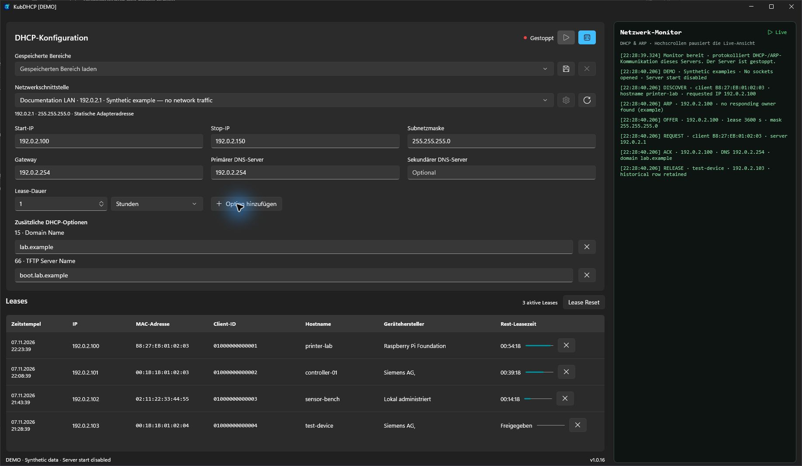
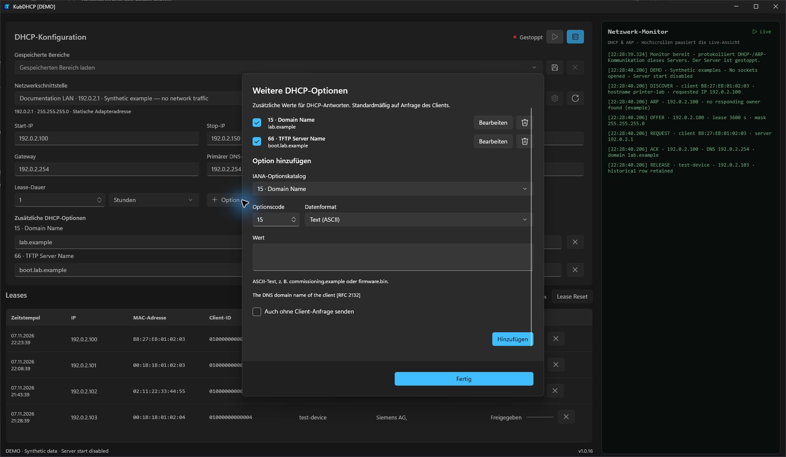
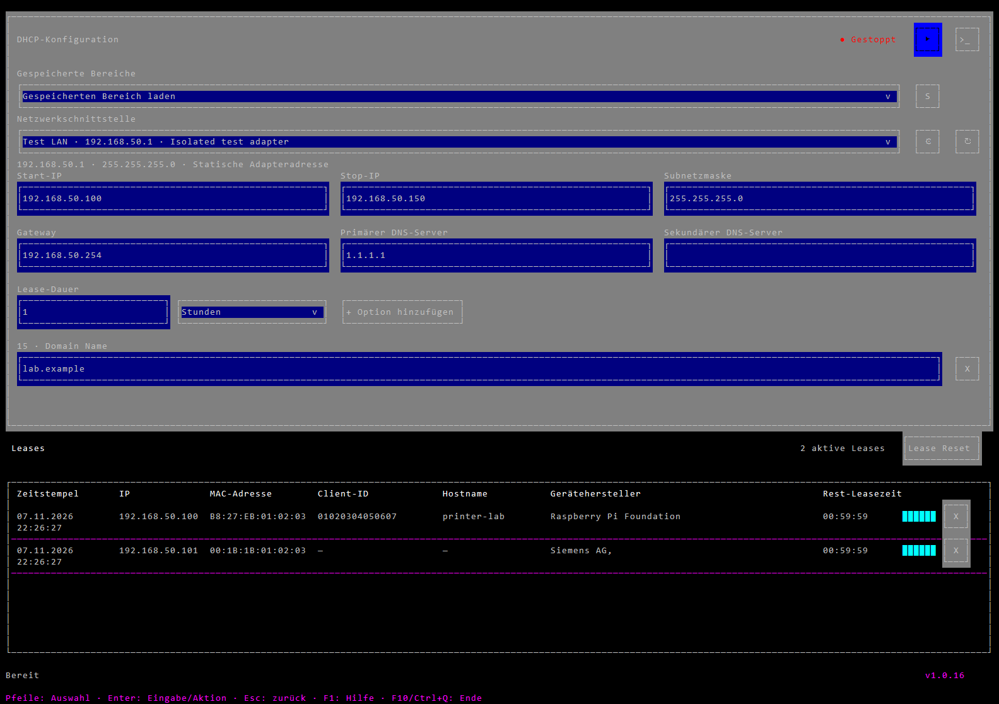
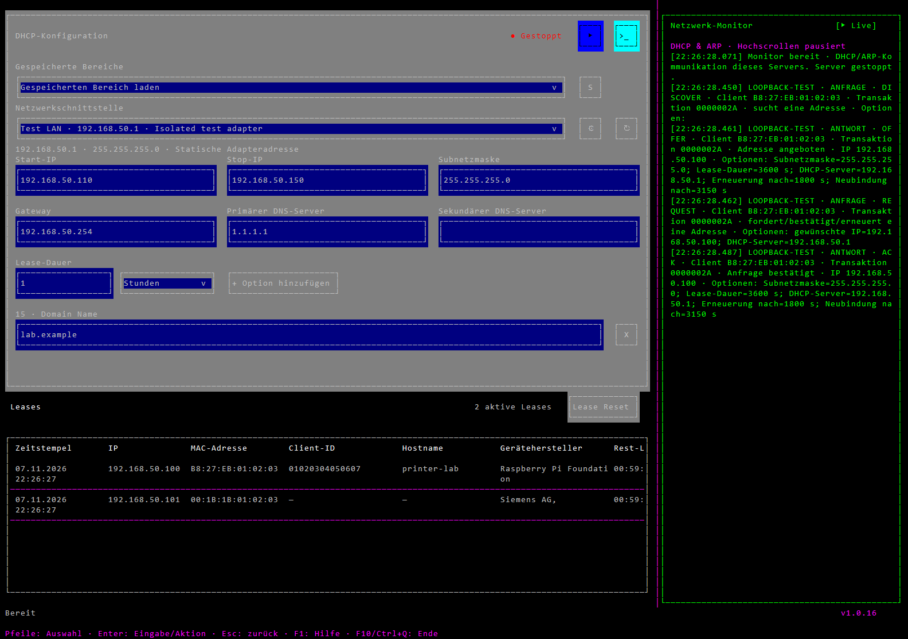

# KubDHCP — Bedienungsanleitung

[English](Manual.en.md) · [Aktuelle Version herunterladen](https://github.com/nkxy1/KubDHCP/releases/latest)

KubDHCP ist ein portabler DHCPv4-Server zur Inbetriebnahme direkt angeschlossener Geräte unter Windows x64. WinUI und Terminaloberfläche verwenden dieselbe EXE, DHCP-Implementierung, Version und Datenablage. Der Server startet immer **gestoppt** und läuft nur, solange die Anwendung geöffnet ist.

## Herunterladen, starten und Sprache

Die **KubDHCP.exe** aus den Release-Anhängen herunterladen. Diesen Dateinamen beibehalten; Versionsnummern gehören in den übergeordneten Ordner, beispielsweise `v1.0.16/KubDHCP.exe`. Eine separate Installation von .NET, Windows App Runtime oder eines Dienstes ist nicht erforderlich. Beim ersten Start entpackt die Einzeldateibereitstellung ihre Laufzeitdateien in den üblichen Cache.

Ein Doppelklick startet WinUI. Die Terminaloberfläche wird aus einer interaktiven PowerShell gestartet:

```powershell
& 'C:\Tools\KubDHCP\KubDHCP.exe' --tui
```

Bei deutscher Windows-Anzeigesprache erscheint das Programm auf **Deutsch**, bei allen anderen Sprachen auf **Englisch**. Nach einer Änderung der Windows-Anzeigesprache das Programm neu starten. Für einen einzelnen Start lässt sich die Auswahl mit `--language=de` beziehungsweise `--language=en` überschreiben, auch zusammen mit `--tui`.

`--demo` zeigt fiktive Adapter, Geräte und Beispielmeldungen. Der Serverstart ist gesperrt; es werden keine DHCP-Sockets geöffnet oder Adapter verändert. Die Wegwerfdaten liegen getrennt unter `%TEMP%\KubDHCP-demo`:

```powershell
& '.\KubDHCP.exe' --demo --language=de
& '.\KubDHCP.exe' --tui --demo --language=de
```

Ein bewusst ausgewähltes Inbetriebnahmenetz verwenden. KubDHCP erkennt andere DHCP-Server nicht zuverlässig. Eine unbeantwortete ARP-Abfrage beweist nicht, dass eine Adresse frei ist.

## WinUI: konfigurieren und starten



Die Abbildung zeigt das echte WinUI-Fenster im Demo-Modus. Geräte und Monitorverkehr sind Beispiele; der DHCP-Server läuft nicht.

1. Die **Netzwerkschnittstelle** auswählen, an der die Geräte angeschlossen sind. Aufgelistet werden aktive IPv4-Adapter. Der kreisförmige Pfeil aktualisiert die Auswahl nach Anschluss oder Umkonfiguration.
2. **Start-IP**, **Stop-IP** und **Subnetzmaske** prüfen. Die Vorgaben stammen vom Adapter. Wenn Subnetz und Infrastrukturadressen es erlauben, wird ein Bereich `.100–.150` vorgeschlagen. Lokale Adapter-, Gateway- und DNS-Adressen werden ausgespart. Andere statisch konfigurierte Geräte lassen sich nicht zuverlässig ausschließen.
3. **Gateway**, **Primärer DNS-Server** und gegebenenfalls **Sekundärer DNS-Server** eingeben oder leer lassen. Ein sekundärer DNS benötigt einen primären. Der Gateway muss im lokalen Subnetz liegen. Das Verteilen dieser Angaben macht KubDHCP nicht zu einem Router oder DNS-Server.
4. Eine positive ganzzahlige **Lease-Dauer** in Sekunden, Minuten, Stunden oder Tagen festlegen. Umgerechnet sind 1 bis 4.294.967.294 Sekunden zulässig. Ein Client darf eine kürzere Dauer anfordern.
5. Benötigte Zusatzoptionen konfigurieren und den **Wiedergabe-Button** zum Starten wählen. Die Statusanzeige wechselt auf „Läuft“, der Button auf **Stoppen**. Symbolbuttons besitzen erklärende Tooltips.
6. Vor Änderungen an Adapter, Pool oder Optionen den Server stoppen. Schließen der Anwendung beendet den Server ebenfalls. Bereits vergebene Clientadressen werden dadurch nicht entzogen.

Geprüft werden unter anderem Subnetzmaske, Poolgrenzen, Infrastrukturüberschneidungen, Dauer und Optionskodierung. Gültige Leases außerhalb eines verkleinerten Pools verhindern den Start. Bei Adapterverlust oder Änderung der ausgewählten IPv4-Konfiguration stoppt der Server.

Das **Zahnrad** öffnet die Windows-Eigenschaften des ausgewählten Adapters. Änderungen wirken auf das Betriebssystem und können Administratorrechte erfordern. Nach der Rückkehr werden die Schnittstellenwerte aktualisiert. Der normale DHCP-Start ändert keine Adapter-, Firewall-, Routing- oder Diensteinstellungen automatisch.

### Bereiche und Entwürfe

Ein benannter Bereich speichert Adapterauswahl, Pool, Maske, Gateway, DNS, Lease-Dauer und Zusatzoptionen. Über das **Speichern-Symbol** einen Namen eingeben und bestätigen. Ein vorhandener Name wird unabhängig von Groß-/Kleinschreibung und äußeren Leerzeichen ersetzt. Über **Gespeicherte Bereiche** lässt sich die Konfiguration bei gestopptem Server wieder laden. Adapter und IPv4-Konfiguration müssen noch passen.

Das benachbarte **X** entfernt den ausgewählten gespeicherten Bereich. Aktuelle Formularwerte, Leases und andere Bereiche bleiben erhalten. Gültige Formularänderungen werden außerdem als aktueller Entwurf gespeichert; benannte Bereiche bleiben separat wiederverwendbar.

### Zusätzliche DHCP-Optionen



**Option hinzufügen** öffnet den offline verfügbaren IANA-Katalog. Einen Eintrag oder einen eigenen Code zwischen 1 und 254 wählen, Datenformat festlegen und Wert eingeben. Beschreibungen, Referenzen und Format-Hilfe stehen im Dialog. Doppelte Codes und protokoll-/clientgesteuerte Optionen werden abgewiesen. Werte aus dem Hauptformular dürfen nicht zusätzlich über diesen Dialog gesendet werden.

| Format | Beispiel und Bedeutung |
| --- | --- |
| Text (ASCII) | `lab.example`; beispielsweise Domäne (15), Bootserver (66), Bootdatei (67) |
| IPv4 | `192.0.2.10`, vier dezimale Oktette |
| IPv4-Liste | `192.0.2.10,192.0.2.11`; Trennung durch Komma, Semikolon oder Zeilenumbruch |
| UInt8 / UInt16 / UInt32 | `120`; vorzeichenlose Ganzzahl, mehrbyteige Werte in Netzwerk-Bytefolge |
| Boolean | `true`/`false`, `1`/`0` oder `ja`/`nein` |
| Domainliste | `lab.example,office.example`; DNS-Labelkodierung für Option 119 |
| Routen | `10.20.0.0/16=192.0.2.254`; je Zeile oder durch Semikolon getrennt eine Netzadresse/Präfix=Gateway, Optionen 121/249 |
| Hex | `01 04 C0 00 02 FE`; vollständige Rohbytes einschließlich Hersteller-Unteroptionen |

**Bearbeiten** ändert einen Eintrag, die Checkbox aktiviert/deaktiviert ihn, das Entfernen-Symbol löscht ihn. Werte können auch direkt im Hauptformular bearbeitet werden. Ungültige Werte sind markiert und verhindern den Serverstart. In der TUI öffnet ein Klick auf den Optionstitel die vollständige Definition. Während des Serverbetriebs sind Optionen schreibgeschützt.

Zusatzoptionen werden normalerweise nur gesendet, wenn der Client ihren Code in seiner Parameter Request List anfordert. **Auch ohne Client-Anfrage senden** hebt diese Einschränkung für die betreffende Option auf. Lange Werte werden gemäß RFC 3396 verkettet. Überschreitet eine Antwort die Clientgrenze, wird sie mit Diagnose verworfen und nicht still abgeschnitten. Eingehendes Option Overload wird ausgewertet; ausgehend wird es nicht verwendet.

### Leasetabelle

Bestätigte Leases zeigen letzte Bestätigung, IP, MAC, übermittelte Client-ID, Hostnamen, registrierten Hersteller sowie Restlaufzeit und Fortschrittsanzeige. Ein OFFER allein erzeugt keinen bestätigten Eintrag. Erneuerungen aktualisieren die Zeile; freigegebene und abgelaufene Leases bleiben als Historie erhalten. Fehlende Client-IDs/Hostnamen erscheinen als Strich. Eine übermittelte Client-ID hat für die DHCP-Identität Vorrang vor der MAC. Hostnamen stammen aus den DHCP-Hostname-/FQDN-Optionen.

Die Herstellersuche verwendet die enthaltene IEEE-Präfixdatenbank ohne Onlineabfrage. Lokal administrierte MAC-Adressen werden entsprechend gekennzeichnet.

- **Rechtsklick** kopiert genau den angeklickten Wert.
- **Spaltentrenner ziehen** verändert benachbarte Spaltenbreiten. Breite Tabellen lassen sich horizontal scrollen.
- Das **X einer Leasezeile** löscht genau diesen gespeicherten Datensatz, auch im laufenden Betrieb. Eine veraltete Auswahl kann keinen inzwischen erneuerten Datensatz löschen. Dem Client wird dadurch seine aktuelle Adresse nicht entzogen.
- **Lease Reset** entfernt alle gespeicherten Leaseeinträge und erfordert einen gestoppten Server. Benannte Bereiche bleiben erhalten. Vorher berücksichtigen, welche Clients noch gültige Adressen besitzen könnten.

Anzahl aktiver Leases und gemeinsame Programmversion stehen bei Tabelle/Fußzeile. Das Formular passt sich der Fensterbreite an und wird bei kleinen Fenstern scrollbar.

### Netzwerkmonitor

Der Monitorbutton öffnet die Seitenleiste. Sie zeigt empfangene und ignorierte Pakete, Anfragen/Antworten, ARP-Prüfungen, Konflikte und Diagnosen einschließlich Clientidentität, Transaktion, Adressen, Laufzeiten und tatsächlich empfangenen/gesendeten Optionen. Erfasst wird die Aktivität dieses Servers, nicht sämtlicher Netzwerkverkehr.

Die Trennlinie verändert die Breite. Hochscrollen pausiert die Live-Ansicht; **PAUSE** blinkt. Ein Klick auf die Statusanzeige pausiert beziehungsweise setzt manuell fort. Am unteren Ende wird automatisch weiterverfolgt, sofern keine manuelle Pause gesetzt ist. Beim Fortsetzen erscheinen gepufferte Meldungen. Ausblenden behält die Breite und die Position/Höhe des Hauptfensters bei. Bei hoher Last meldet die begrenzte Warteschlange ausgelassene Einträge.

## Terminaloberfläche (TUI)





Diese TUI-Abbildungen stammen aus den tatsächlichen Zeichen-/Farbattributpuffern der Anwendung mit fiktiven Testgeräten, nicht aus gezeichneten Mockups. Native Ein-/Ausgabe und DHCP-Kommunikation werden zusätzlich separat über isolierte Loopback-Ports geprüft.

`--tui` läuft in der aufrufenden interaktiven PowerShell-/SSH-Sitzung. Es wird keine Ersatzkonsole und kein grafischer Dialog geöffnet. PowerShell wartet bis zum Ende; vorheriger Bildschirm, Eingabemodi und Cursor werden wiederhergestellt. Größenänderungen passen Spalten, Scrollen und Dialoge an, ohne das WinUI-Layout zu ändern. WinUI und TUI dürfen nicht gleichzeitig auf dieselben Benutzerdaten zugreifen.

| Aktion | Tastatur oder Maus |
| --- | --- |
| Auswählen | Räumliche Pfeiltastennavigation; Tab / Shift+Tab; Klick |
| Ausgewähltes Feld aktivieren | Enter; Auswählen allein nimmt noch keine Texteingabe an |
| Eingabe übernehmen / verwerfen | Enter / Escape; Ctrl+Enter bei mehrzeiligem Text |
| Alles markieren / einfügen | Ctrl+A / Ctrl+V während der Eingabe oder Einfügen des Terminals |
| Button/Dropdown bedienen | Enter / Leertaste oder Klick |
| Tabelle/Monitor bedienen | Enter, Pfeile und Bild auf/ab; Escape zurück zur Navigation |
| Tabellenwert kopieren | Rechtsklick |
| Spalten/Monitor skalieren | Kopf/Trennlinie ziehen |
| Vollständige Optionsdefinition | Optionstitel anklicken |
| Hilfe / Dialog schließen | F1 / Escape |
| Beenden | F10 / Ctrl+Q |

Die oberen Buttons bieten Start/Stopp, Monitor, Bereich speichern (`S`), Bereich entfernen (`X`), Adaptereinstellungen (Zahnrad) und Aktualisieren. Zeilen-`X` und **Lease Reset** entsprechen WinUI. Formular, Bereiche, Optionen, Leasehistorie und Monitorfunktionen werden gemeinsam verwendet.

Der TUI-Adapterdialog kann DHCP-Adressierung anfordern oder statische IPv4-Adresse, Maske, Gateway und DNS mit Windows `netsh` setzen. Dafür ist eine erhöhte Sitzung erforderlich. Die Änderung der SSH-Schnittstellenadresse kann die Verbindung trennen; den Hinweis vor dem Übernehmen beachten. Es öffnet sich kein grafischer Adapterdialog.

### SSH

Zu einem Windows-SSH-Server mit Pseudokonsolenunterstützung mittels `ssh -t benutzer@windows-host` verbinden und dort `KubDHCP.exe --tui` starten. Verwendet werden Schnittstellen, Firewallrechte und Benutzerprofil des **entfernten Rechners**. Mausbedienung benötigt SGR-Mausunterstützung/-Weitergabe des Terminals. Shift erlaubt häufig die lokale Textauswahl bei aktiver Mausweitergabe. Kopieren verwendet über SSH OSC 52; das lokale Terminal muss dies zulassen. Die Desktop-Zwischenablage des entfernten Rechners wird in SSH-Sitzungen nicht beschrieben. Lokale ConPTY-Tests ersetzen keinen Test einer echten entfernten SSH-Verbindung.

## Benutzerdaten, Sicherungen und Übernahme

Ab v1.0.16 liegen die regulären Programmdaten im Profil des aktuellen Windows-Benutzers:

```text
%LOCALAPPDATA%\KubDHCP
```

Üblicherweise ist dies `C:\Users\<Benutzer>\AppData\Local\KubDHCP`. Beide Oberflächen und unterschiedliche EXE-Kopien/-Versionen verwenden diesen gemeinsamen Ordner. Verschieben der EXE verschiebt die Daten nicht. Neben die EXE wird kein Anwendungszustand geschrieben.

| Datei | Inhalt |
| --- | --- |
| `settings.json` | Aktuelle gültige Konfiguration und Zusatzoptionen |
| `ranges.json` | Benannte Konfigurationen |
| `leases.json` | Dauerhafte Leasebelegungen über Neustarts hinweg |
| `*.json.bak` | Vorheriger Stand der entsprechenden JSON-Datei |
| `KubDHCP.log` | Serveraktivität und Fehlerdiagnose |
| `Lizenzen.txt`, `KubDHCP.ico` | Mitgelieferte Lizenzhinweise und extrahiertes Symbol |

Existiert der Benutzerordner beim ersten Start noch nicht, werden alte Dateien aus `KubDHCP.data` neben dieser EXE in das Profil kopiert. Die vollständige Kopie wird vorbereitet, bevor der neue Ordner aktiv wird; Originaldateien bleiben erhalten. Ein vorhandener Benutzerordner hat Vorrang: keine Zusammenführung oder Überschreibung. Nach der Übernahme keine ältere EXE gegen die alte Kopie betreiben, da sonst getrennte Leasedatenbanken entstehen.

Für Sicherung, Umzug oder Wiederherstellung das Programm stoppen und den vollständigen Datenordner kopieren. Beschädigte Leasedaten verhindern den Start. `leases.json` und Sicherung prüfen, statt Belegungen unbedacht zu löschen, solange Clients ihre Adressen noch nutzen könnten. Startdiagnosen können in `%TEMP%\KubDHCP-startup.log` oder `%TEMP%\KubDHCP-unhandled.log` stehen. Demo- und automatisierte Testdaten liegen getrennt in temporären Ordnern.

## Fehlerbehebung und Funktionsumfang

| Problem | Prüfung |
| --- | --- |
| Kein Adapter | Netz verbinden, reguläre IPv4-Adresse in Windows konfigurieren und aktualisieren. Loopback/Tunnel werden ausgeblendet, ungültige/APIPA-Serveradressen abgewiesen. |
| UDP 67 belegt | Anderen DHCP-Server beziehungsweise Windows-Internetfreigabe prüfen. |
| Kein Lease | Adapter, Subnetz/Pool, Verkabelung sowie Firewallfreigabe für EXE und UDP 67/68 prüfen. Ignorierte Pakete, Konflikte und zu große Optionen stehen im Monitor. |
| Pool erschöpft | Aktive Leases, Angebote und Konflikte prüfen. Angebote laufen nach 30 Sekunden ab; Konflikte sind zehn Minuten gesperrt. RELEASE gibt die Adresse frei und erhält die Historie. |
| Optionen schreibgeschützt | Vor Änderungen den Server stoppen. |
| Bereich nicht verfügbar | Ursprünglicher Adapter mit passender Adresse/Maske muss verfügbar sein. |
| TUI startet nicht | Interaktives Terminal verwenden, bei SSH mit `ssh -t` anfordern. Es öffnet sich kein Ersatzfenster. |

Unterstützt werden DHCPv4 DISCOVER/OFFER, REQUEST/ACK/NAK, Renew/Rebind, RELEASE, DECLINE und INFORM für direkt angeschlossene Ethernet-Clients. Empfangsinterfaceprüfung und explizite Quell-/Interfaceauswahl begrenzen Antworten auf den gewählten Adapter. Initiale Antworten nutzen den RFC-2131-Broadcast-Fallback; Erneuerungen können Unicast verwenden. Client-ID, Hostname/FQDN, eingehendes Option Overload und verkettete Optionen werden verarbeitet.

Nicht enthalten sind DHCPv6, DHCP-Relay, BOOTP, Reservierungsverwaltung, DNS, NAT, Routing, TFTP- oder HTTP-Dienste. Bootoptionen verteilen Angaben, stellen aber keine Dateien bereit.

## Bauen und prüfen

Windows x64, PowerShell 7 und .NET SDK 10.0.403 oder eine konfigurierte kompatible Patchversion verwenden:

```powershell
.\scripts\Build.ps1
```

Das Skript verwendet `.tools/dotnet/dotnet.exe`, falls vorhanden, sonst das installierte SDK. Es führt Kerntests aus, veröffentlicht `dist/KubDHCP.exe` und prüft nativen Loopbacktransport, echtes WinUI-Fenster, veröffentlichte TUI und direktes PowerShell-/ConPTY-Verhalten auf **Deutsch und Englisch**. Im produktiven LAN wird kein DHCP-Server gestartet. Microsoft-Windows-SDK-/WinRT-Assemblys können generische IL2104-Trimmingwarnungen ausgeben.

Die Version pro angeforderter Änderungsiteration einmal mit `scripts/Bump-Version.ps1` erhöhen. Nach Patch 100 folgt die nächste Minorversion mit Patch 0. Das App-Projekt ist die gemeinsame Versionsquelle für EXE und beide Oberflächen. Drittanbieterhinweise und Offline-Datenquellen sind im Quellcode enthalten. Reale DHCP-Geräte und echte entfernte SSH-Verbindungen benötigen ergänzende Prüfung in der jeweiligen Umgebung.
